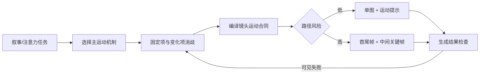

# 40 种运镜方式与 AI 运镜提示词逻辑 - Skill Index

> 本地视频经蒸馏后产出 1 个 Skill。处理日期：2026-08-31。

## 来源概况

- 作者/讲者：未识别
- 发布年份：未知
- 来源文件：`/Users/guopeng/Desktop/332b1c163f4b2f16dec89dbcbf319e59.mp4`
- 一句话主旨：先按叙事任务选择运动机制，再把镜头写成有起点、路径、速度、主体固定项、环境响应和落点的可执行提示词。
- [全局理解](./BOOK_OVERVIEW.md)
- [精华总结](./DIGEST.md)
- [术语词典](./GLOSSARY.md)

## Skill

- [`cinematic-shot-prompting`](./cinematic-shot-prompting/SKILL.md)：将画面或叙事意图编译成模型无关、可检查、可修改的镜头运动提示词。

## 结构关系

本次只有一个 Skill，没有为了图谱丰富而拆出互相抢触发的兄弟 Skill。40 类镜头模式、选择规则和失败诊断作为该 Skill 的按需参考文件。

## 推荐阅读顺序

1. [精华总结](./DIGEST.md)：理解方法和边界。
2. [Skill 本体](./cinematic-shot-prompting/SKILL.md)：查看触发与执行流程。
3. [镜头选择](./cinematic-shot-prompting/references/shot-selection.md)：按叙事任务选动作并消歧。
4. [提示词语法](./cinematic-shot-prompting/references/prompt-grammar.md)：编译可直接使用的提示词。
5. [40 类镜头模式](./cinematic-shot-prompting/references/shot-patterns.md)：点名镜头时按需查找。
6. [失败诊断](./cinematic-shot-prompting/references/repair-guide.md)：生成不符合预期时逐槽修改。

## 安装状态

当前目录是已校验前的构建产物，不会自动成为全局 Skill。安装需要用户确认目标：

- 用户级：`~/.codex/skills/cinematic-shot-prompting/`
- 当前项目级：`/Users/guopeng/Documents/ChatGPT/制作skill/.codex/skills/cinematic-shot-prompting/`

## 审计轨迹

- [候选单元](./candidates/)
- [三重验证](./verified.md)
- [淘汰项](./rejected/)
- [压力测试](./cinematic-shot-prompting/test-results.md)
- [流水线状态](./PIPELINE_STATE.md)
