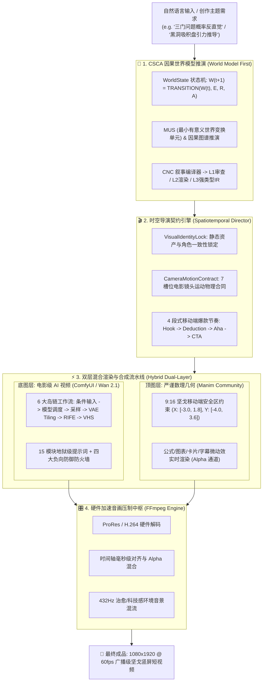

# 📱 Manim Shorts - 全链路智能短视频创作工作流 (AI Video + Manim Pipeline)

<p align="center">
  
  
  
  
  
  
  <a href="https://github.com/287523023qq-hue/manim-shorts"></a>
</p>

> **面向移动端（抖音、小红书、微信视频号、YouTube Shorts、TikTok）的下一代智能短视频全栈创作系统。**  
> 融合 **CSCA 世界模型第一原则**、**Hell Grind 15 模块影视工业级提示词**、**ComfyUI 6 大岛链可视化画布** 与 **Manim 9:16 安全区数学/逻辑动画双层混合压制**。

<div align="center">
  <a href="https://github.com/287523023qq-hue/manim-shorts">
    
  </a>
  <p align="center">
    <strong>⚡ 广播级双层混合渲染成片演示 (ComfyUI 电影级底图 + Manim 9:16 严谨数理几何前景)</strong><br>
    <em>从自然语言需求到因果状态机推演，毫秒级时间轴对齐压制，告别五毛特效与逻辑崩塌</em>
  </p>
</div>

---

## ⚡ 30 秒极速体验 (30s Quickstart)

无需繁琐配置，一条命令直接跑通从分镜到渲染的全流程：

```bash
# 1. 克隆代码并进入目录
git clone https://github.com/287523023qq-hue/manim-shorts.git
cd manim-shorts

# 2. 一键秒级草稿预览 (540x960 20fps 极速调试)
./run.py preview EulerShortScene

# 3. 对话式一键推演与生成 (输入一句话直接推演、编译并派发)
./run.py generate "修仙剑修在暴风雪山巅拔剑，剑气化作金龙冲天而起，镜头慢速推近，6秒"

# 4. 广播级母带压制输出 (1080x1920 60fps)
./run.py render BinarySearchScene
```

---

## 🏗️ 系统全景架构 (System Architecture)



---

## ✨ 核心特性

### 1. 🧠 CSCA 世界模型第一原则 (World Model First)
- 在生成任何视听画面之前，AI 必须首先在内存中完成因果与状态推演；
- 状态转移方程：$W(t+1) = \text{TRANSITION}(W(t), E, R, A)$；
- 包含 `INFER`（推断）、`CONSTRUCT`（构建）、`SIMULATE`（模拟）、`VALIDATE`（校验）、`MAINTAIN`（维护）五大核心状态算子；
- 每一个镜头切换必须严格对应一个 **MUS（最小有意义世界变换单元）**。

### 2. 🎥 7 槽位电影镜头运动物理合同 (Camera Motion Contract)
- 彻底消灭“高级感”、“震撼镜头”等无法量化的主观词；
- 严格由 **起始构图、运镜机制、几何路径、速度曲线与制动、终止构图落点、主体屏幕坐标锁定、环境视差物理响应** 7 个插槽组成，支持单图、首尾双帧与跨尺度运镜。

### 3. 📝 Hell Grind 15 模块影视工业级提示词
- **15 模块解耦**：场景上下文、活跃参考物、地理空间图、首帧调度、画幅格式、光学参数、摄影机运动、按秒动作时序表、流体与动力学、光影体积光、声景、角色微表情、艺术风格、画面纯净度、正向针对性约束；
- **四大防御防火墙**：解剖姿态防御、特征漂移防御、视线偏离防御、画质伪影防御；
- **三层解耦输出**：L1 极简审查卡（~200B）、L2 大模型纯净提示词（~2KB）、L3 强类型后期 IR（~4KB）。

### 4. 🛠️ ComfyUI 6 大岛链可视化画布 (Ready-to-Drag)
- 告别乱成麻线的面条式节点，采用模块化“岛链设计”：
  1. **条件输入岛 (Conditioning)**
  2. **模型调度岛 (Model Loader - FP8 / Offload)**
  3. **高精度采样岛 (Sampling - Euler / UniPC)**
  4. **VAE 切块解码岛 (VAE Tiling - 零 OOM 导出长视频)**
  5. **运动平滑与补帧岛 (RIFE VFI - 16fps 升频 60fps)**
  6. **输出与合成岛 (VHS Combine)**
- 预置 **Wan 2.1** 与 **HunyuanVideo** 工业级生产画布与纯数据 API JSON 模板。

### 5. 📱 9:16 坚戈移动端避坑安全区
- 自动避让手机状态栏、搜索栏、右侧点赞转发柱（约 12% 边缘）与底部大段文案区（约 20% 空间）；
- 核心内容锁定在黄金矩形内（`X: [-3.0, 1.8], Y: [-4.0, 3.6]`），拒绝任何平台交互遮挡。

---

## 📂 项目结构

```text
manim-shorts/
├── comfyui_workflows/              # 🎨 6 大岛链 ComfyUI 可视化拖拽画布
│   └── wan21_hunyuan_production_pipeline.json
├── docs/                           # 📚 深度架构与标准作业程序 (SOP)
│   ├── CSCA_WORLD_MODEL_ARCHITECTURE.md
│   ├── HELL_GRIND_15_MODULE_PROMPT_ENGINEERING.md
│   └── SPATIOTEMPORAL_DIRECTOR_CONTRACT.md
├── output/                         # 📦 生成产物 (API Payloads, 视频, 图片)
│   ├── payloads/                   # 自动编译的 ComfyUI 投喂载荷
│   └── videos/                     # 渲染后的成品视频
├── scenes/                         # 🎬 Manim 竖屏几何动效代码
│   ├── binary_search.py            # 算法演示: 二分查找对半砍
│   ├── euler_identity.py           # 数学之美: 欧拉公式几何真相
│   └── 三门问题_scene.py            # 概率悖论: 三门问题决断
├── src/manim_shorts/               # 🧩 核心 Python 全栈框架
│   ├── world_model/                # CSCA 世界模型、MUS状态转移、15-Module 编译器
│   ├── director/                   # 视觉资产锁、7槽位运镜合同、时空导演引擎
│   ├── comfyui/                    # REST/WebSocket API 客户端与节点注入器
│   └── pipeline/                   # 对话生成引擎、双层合成器、项目编排总控
├── storyboards/                    # 📝 视频文案与分镜台本库
├── run.py                          # 🚀 统一命令行工具 (CLI 中枢)
├── manim.cfg                       # 竖屏 9:16 数学与图形渲染配置
└── pyproject.toml                  # 依赖管理配置
```

---

## 🚀 快速上手 (Quick Start)

### 1. 环境准备
本项目采用 `uv` 或原生 Python 虚拟环境管理：

```bash
# 克隆仓库
git clone https://github.com/287523023qq-hue/manim-shorts.git
cd manim-shorts

# 安装依赖
pip install -e .
# 或使用 uv 极速同步
uv sync
```

### 2. CLI 命令行中枢 (`./run.py`)

统一入口脚本 `run.py` 内置**环境自愈重入机制**，即使直接调用系统 Python，也会自动切换至专属虚拟环境运行：

```bash
# 查看所有可用命令与场景列表
./run.py list

# ⚡ 秒级草稿预览 (540x960 20fps，调试动画与逻辑)
./run.py preview EulerShortScene

# 💎 1080P / 4K 广播级母带渲染 (1080x1920 60fps)
./run.py render BinarySearchScene

# 📸 导出单帧高清封面图 (1080x1920 PNG)
./run.py snapshot 三门问题GeneratedScene

# 🧠 全链路智能创建 (根据主题生成分镜、Manim场景与ComfyUI载荷)
./run.py create 蒙提霍尔三门问题

# 💬 对话式一键生成 (输入一句话直接推演、编译15模块并派发生成)
./run.py generate "修仙剑修在暴风雪山巅拔剑，剑气化作金龙冲天而起，镜头慢速推近，6秒"

# 🎛️ 音画双层硬件合成 (将 ComfyUI AI 视频底模与 Manim 前景几何融合成最终成片)
./run.py composite output/videos/ai_bg.mp4 output/videos/manim_fg.mp4

# 🔌 探测本地 ComfyUI API 连通性 (127.0.0.1:8188)
./run.py comfy-check
```

---

## 🎨 ComfyUI 协同说明

1. 启动本地 ComfyUI 服务（默认监听 `http://127.0.0.1:8188`）；
2. 打开浏览器，将 `comfyui_workflows/wan21_hunyuan_production_pipeline.json` 直接拖拽到画布中；
3. 本工程的 `run.py generate` 亦可通过 WebSocket API 动态注入参数，实现纯代码批量无缝产出。

---

## 📄 开源许可证 (License)

本项目遵循 [MIT License](LICENSE)。欢迎提交 Issue 与 Pull Request 共同共建下一代智能短视频创作基础设施！
