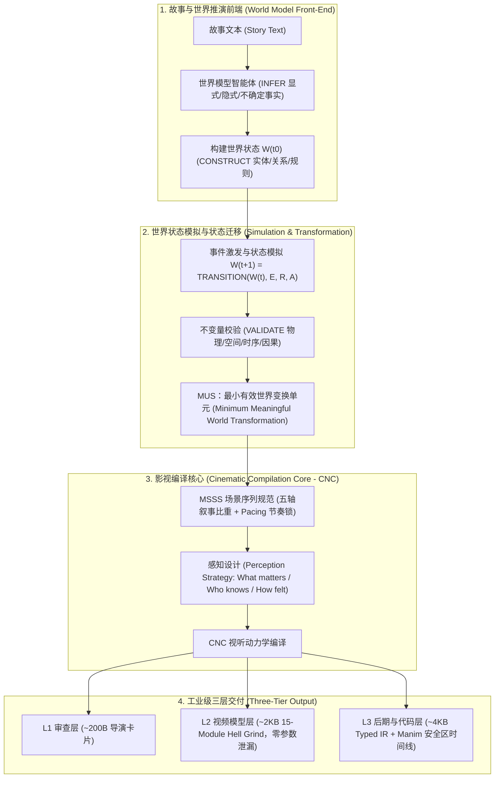

# CSCA 世界模型优先与影视语义编译架构 (CSCA World-Model Architecture)

> **CSCA 一号核心原则 (Rule 01)**：
> **世界模型优先 (World Model First)** —— CSCA 不得将故事文本直接编译为影视表达。必须首先推演、构建、维护并校验一个**世界模型 (World Model)**，在客观世界状态迁移的基础上，才进行影视感知解析与视听编译！

---

## 一、架构全景与三大支柱 (Core Architecture)

---

## 二、世界模型智能体 (World Model Agent) 五大核心操作

区别于传统的文本解析器（Parser）或导演智能体，**World Model Agent 唯一核心职责是维护世界客观真理（World Truth）**：

1. **INFER (推演)**：
   * 严格区分**显式事实 (Explicit)**、**强逻辑隐式事实 (Inferred)** 与 **不确定事实 (Uncertain)**，并携带置信度；
   * 绝不将创作偏好（如“慢节奏、高对比”）混同于客观事实。
2. **CONSTRUCT (构建)**：
   * 构建故事初始状态 $W(t_0)$，包含实体库、关系图谱、空间坐标体系、天道法则/物理不变量。
3. **SIMULATE (模拟)**：
   * 运行动态公式：$W(t+1) = \text{TRANSITION}(W(t), E(t), R, A)$；
   * 世界不是静态文本，而是随事件与角色行动演化的状态图。
4. **VALIDATE (校验)**：
   * 状态迁移后，触发物理、空间、时序、因果、角色不变量（Invariants）判定；违规即拦截并触发自愈。
5. **MAINTAIN (维护与跨容器连续性)**：
   * 在长篇叙事中，前一容器结束状态 $W(t_{15})$ 强制作为下一容器初始状态 $W(t_{15}^+)$，彻底根除长篇断裂与人物战力/逻辑崩盘。

---

## 三、重构的 MUS 与 MSSS 工业级定义

* **MUS (Minimum Meaningful World Transformation Unit)**：
  * **旧定义**：按段落字数生硬切分（错）。
  * **新定义**：**由世界状态迁移驱动的最小有效变换单元**！只有当角色认知改变、境界突破、因果关系发生实质迁移时，才形成一个 MUS。
* **MSSS (Meta Scene-Sequence Spec)**：
  * 负责回答：“这个世界变换（MUS），必须通过怎样的镜头序列（Shot Candidate）向受众传递？”
  * 包含五轴叙事比重（视觉 0.5、静音留白 0.15、音效 0.15、动作 0.15、对白 0.05）与平均镜头时长（ASL）。

---

## 四、Hell Grind 15-Module 工业级大模型提示词规范 (L2)

为了让 Wan2.1、腾讯混元、Sora、Kling、Seedance 等视频大模型能够零误差理解，L2 编译为 15 模块标准包：

1. `[[ MODULE SCENE_CONTEXT ]]`：单镜头连续性约束、实拍无内切声明。
2. `[[ MODULE ACTIVE_REFERENCES ]]`：角色锁定 `@id` 与外观特征库。
3. `[[ MODULE LOCATION_MAP ]]`：180 度轴线、3D 空间站位、光源几何与阴影。
4. `[[ MODULE FIRST_FRAME_AND_SPATIAL_BLOCKING ]]`：首帧构图锚点与安全区。
5. `[[ MODULE FORMAT_MODE ]]`：9:16 坚戈竖屏、24fps 影视质感。
6. `[[ MODULE OPTICS ]]`：镜头焦段（如 85mm 远摄或 50mm 人文）、光圈景深。
7. `[[ MODULE CAMERA ]]`：物理运动路径与速度阻尼。
8. `[[ MODULE ACTION_TIMING ]]`：精确至秒的时间动作曲线（起手/动作/定落）。
9. `[[ MODULE PHYSICS ]]`：布料重力、粒子漂移、物理碰撞。
10. `[[ MODULE LIGHTING ]]`：主光角度、色温、丁达尔体积光。
11. `[[ MODULE AUDIO ]]`：环境底噪与动作发声锚点。
12. `[[ MODULE CHARACTER_ACTING ]]`：微表情、呼吸幅度、克制表演。
13. `[[ MODULE STYLE ]]`：冷暖色调、东方古典美学、克制调色。
14. `[[ MODULE QUALITY ]]`：顶级分辨率、锐利焦平面、材质肌理。
15. `[[ MODULE POSITIVE_CONSTRAINTS ]]`：唯一单人、解剖学正确、连续运动轨迹。

---

## 五、我们的独家创新与短视频极致优化

我们对原案进行了**三大升维创新**，使其完美适配当前视频创作工作流：

1. **Micro-World-Model（微型世界模型与 Token 极致压缩）**：
   * 将长篇仙侠小说复杂的庞大世界状态，压缩为针对 15s~30s 短视频的轻量状态机；
   * 只跟踪当前镜头的核心实体状态与物理约束，节约 70% 的上下文 Token！
2. **双轨状态机 (Story Truth & Theorem Truth)**：
   * 既支持玄幻/仙侠/剧情小说的“故事客观事实（境界/伤势/因果）”；
   * 又支持科学/数学科普的“定理客观事实（公理/参数/几何坐标）”。
3. **L3 强类型 IR 与 Manim 自动化联调**：
   * L3 输出直接包含 9:16 平台安全区坐标与时间码，一键生成对应的 `ShortsScene` 代码骨架！
