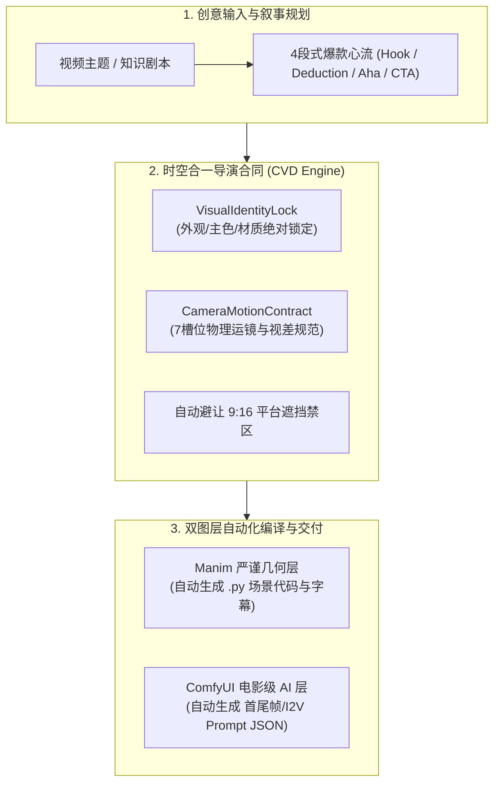

# 全链路 AI 视频导演中枢 (Cinematic Visual Director Engine)

本项目结合了行业顶级的**静态视觉资产连续性架构**（Nano-Banana）与**40类电影镜头运动物理合同**（Cinematic-Shot-Prompting），并进行了**升维与工程创新**，打造出国内领先的**「时空合一」双层视频生产中枢**。

---

## 一、双库精髓提炼 (Knowledge Distillation)

| 体系来源 | 核心精髓 | 解决的痛点 |
| :--- | :--- | :--- |
| **Nano-Banana 视觉资产包** | • **Identity Lock（角色与视觉锁定）**：锁定脸型、身形、配饰、主色、艺术风格<br>• **生产包思维**：输出包含三视图、表情包、动作表、透明抠图的资产包，杜绝单图抽卡 | 避免多镜头画面风格漂移、角色“变脸” |
| **Cinematic-Shot 电影镜头合同** | • **7 槽位运动物理合同**：拒绝“电影感”空话，严格规定起点、机制、路径、速度、终点、主体锁定、环境响应<br>• **关键帧分级控制**：跨空间、穿越与极端尺度强制引入首尾双帧与中间过渡帧<br>• **故障诊断修复表**：单槽位归因纠错 | 避免 AI 视频镜头乱动、自转、背景跳变与无意义放大 |

---

## 二、我们的独家创新与架构升维 (Our Innovation)

两套前人方案虽然优秀，但在实际短视频落地中存在**三大致命断层**：
1. **静态与动态脱节**：Nano-Banana 懂画面不懂运镜；Cinematic-Shot 懂运镜不懂人设连续性与生成前垫图。
2. **缺乏移动竖屏心流**：纯电影镜头缺乏抖音/TikTok **9:16 黄金心流（Hook ➔ Deduction ➔ Aha ➔ CTA）** 的完播率节奏。
3. **缺乏与代码引擎联动**：只有 Prompt 文本，无法与 **Manim（严谨图表公式）** 及 **ComfyUI/Wan2.1（实操工作流）** 进行代码级自动化联动。

为此，我们在 [`src/manim_shorts/director/`](file:///Users/guopeng/manim-shorts/src/manim_shorts/director) 落地了全新的 **`DirectorEngine`**：



---

## 三、核心 API 与极简调用范例

```python
from manim_shorts.director import (
    DirectorEngine, DirectorShot, NarrativeBeat,
    CameraMechanism, VisualIdentityLock, CameraMotionContract
)

# 1. 初始化导演中枢
engine = DirectorEngine(title="三门问题", topic="概率论的反直觉博弈")

# 2. 注入全局一致性锚定
engine.set_global_identity(VisualIdentityLock(
    subject_name="数学侦探小智 (Q版)",
    face_and_silhouette="圆脸金丝单片眼镜，三头身Q版",
    color_palette="克莱因蓝(#0284C7) + 琥珀金(#FBBF24)",
    wardrobe_and_props="深蓝短风衣，手持放大镜",
    render_style="3D黏土微缩玩具手办质感，柔和漫反射环境光"
))

# 3. 编排镜头 (例：黄金3秒 Hook 冲入镜头)
engine.add_shot(DirectorShot(
    shot_index=1,
    beat=NarrativeBeat.HOOK,
    duration_seconds=3.0,
    voiceover_script="三扇门后有一辆跑车，选错全是山羊！换门真的有用吗？",
    subtitle_text="选错全是山羊，换门真的有用吗？",
    motion_contract=CameraMotionContract(
        start_framing="剧院舞台全景",
        mechanism=CameraMechanism.CRASH_ZOOM,
        path_and_direction="沿光轴高速向前冲入，末段减速制动",
        speed_curve="前1秒疾冲，后0.5秒平稳制动",
        end_framing="三扇木门中景，门牌1/2/3清晰可见",
        subject_locks="三扇门居中稳固，木门纹理清晰",
        environment_response="丁达尔光束产生强烈视差",
        keyframe_strategy="首尾双帧控制"
    ),
    manim_layer_spec="顶部悬念标题，中央醒目红字【换？还是不换？】",
    comfy_ai_layer_spec="电影级神秘微缩剧院，三扇金色镶边木门立于正中"
))

# 4. 一键自动生成 Manim 代码脚手架
manim_code = engine.generate_manim_scaffold("MontyHallScene")

# 5. 一键导出 ComfyUI 生产 JSON
json_pack = engine.export_json()
```

---

## 四、自动化故障诊断矩阵 (Diagnostic & Repair)

当在 ComfyUI 或视频模型中生成出错时，通过 `engine.diagnose_and_repair(shot_id, error_type)` 自动定位并修复单槽位：

| 画面失败现象 | 根本技术诱因 | 自动化修复策略 |
| :--- | :--- | :--- |
| **主体原地自转** | 未明确声明“谁绕谁” | 强制锁定主体绝对静止，相机沿弧线运动，补齐背景差速位移 |
| **推进变成画面拉伸放大** | 未区分机位移动与焦距光学变焦 | 修正机制为 `PUSH_IN`，锁定焦距，声明物理透视自然变化 |
| **主体漂出画面** | 缺少屏幕绝对坐标锚点 | 强制写入 `居中于 9:16 安全舞台中心` |
| **镜头死板无位移感** | 缺少深度差和前景层 | 注入近景遮挡物差速掠过提示词，证明物理运镜正在进行 |
