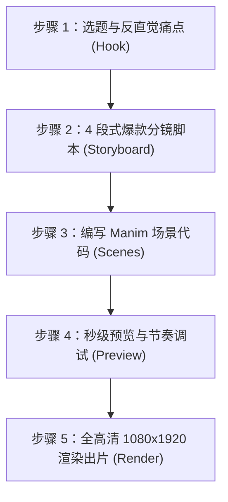

# 竖屏科普短视频创作工作流 (Vertical Video Production Workflow)

本项目专为**抖音、TikTok、视频号、B站、小红书**等平台打造极致视觉的 9:16 坚戈竖屏科学/数学/算法科普动画。基于 Python 3.12 与 Manim Community v0.22.0 构建。

---

## 一、核心命令速查 (CLI Cheat Sheet)

所有命令均已封装在根目录的 [`run.py`](file:///Users/guopeng/manim-shorts/run.py) 中，自动强制注入 9:16 竖屏分辨率，无需记忆 Manim 复杂的 CLI 参数：

| 操作 | 命令 | 说明 | 适用场景 |
| :--- | :--- | :--- | :--- |
| **列出全部场景** | `./run.py list` | 扫描 `scenes/` 目录下所有可用 Scene 类 | 查看现有场景名 |
| **秒级极速预览** | `./run.py preview --scene <SceneName>` | 540x960, 20fps 极速渲染并自动弹窗播放 | 调试动效与排版 |
| **截取静止快照** | `./run.py snapshot --scene <SceneName>` | 截取动画最后一帧 1080x1920 高清 PNG | 制作视频封面 |
| **全高清正式出片** | `./run.py render --scene <SceneName> -qh` | 1080x1920, 60fps 顶级画质出片 | 最终发布提交 |
| **标清平衡出片** | `./run.py render --scene <SceneName> -ql` | 720x1280, 30fps 快速成片 | 移动端测试 |

---

## 二、平台安全区与设计美学规范 (Visual Standards)

竖屏短视频最致命的问题是**内容被平台 UI 遮挡**（右侧的点赞/评论/分享按钮栏、底部的文案/头像/进度条）。

### 1. 安全视觉舞台 (Safe Visual Stage)
所有动画核心主体必须限制在安全区域内：
* **顶部安全区**：$Y \in [3.0, 4.0]$（预留给分类徽标、主标题、顶部进度条）。
* **核心内容区 (Stage)**：中心 $Y = -0.4$，$W \le 6.0$，$H \le 5.6$（自动避让平台右侧 1.2 单元按钮栏）。
* **底部安全区**：$Y \in [-4.0, -3.0]$（沉浸式毛玻璃字幕条）。
* **绝对避让禁区**：$Y < -4.2$（各平台作者信息、发布时间、音乐标题、系统手势条覆盖区）。

### 2. 高级暗黑配色哲学 (Dark Aesthetic Tokens)
* **背景底色**：`#09090B`（Zinc 950 墨黑深空，拒绝死黑与死白）。
* **容器卡片底色**：`#18181B` 配合 `#27272A` 微边框（Zinc 900/800）。
* **主文本**：`#F4F4F5`（柔和白，对比舒适）。
* **次级说明文本**：`#A1A1AA`（冷灰，层级分明）。
* **视觉聚焦品牌色 (Cyan)**：`#38BDF8`（Sky 400，用于核心推导与动态光标）。
* **顿悟时刻点缀色 (Gold)**：`#FBBF24`（Amber 400，用于核心公式与爆点结论）。

---

## 三、标准化视频创作 5 步闭环流



### 步骤 1：选题与痛点锚定 (Topic Selection)
选择具有“直觉与真相反差”的科学/数学/逻辑主题，例如：
* **蒙提霍尔三门问题**（为什么换门概率直接翻倍至 2/3？）
* **二分查找的力量**（43 亿次操作只需对比 32 次）
* **欧拉恒等式**（数学中最美公式的几何螺旋推导）
* **光速不变与时间膨胀**（为什么跑得越快老得越慢？）

### 步骤 2：4 段式爆款分镜脚本 (4-Stage Scripting)
使用 [`storyboards/template_short_script.md`](file:///Users/guopeng/manim-shorts/storyboards/template_short_script.md) 编写脚本，严格按照黄金时间节奏：
1. **0~3s [痛点 Hook]**：抛出颠覆直觉的问题，让观众停下滑动。
2. **3~18s [直觉推导 Deduction]**：动态图表逐步展现，禁止大段公式堆砌。
3. **18~25s [顿悟时刻 Aha Moment]**：高光卡片揭晓真相，产生认知震颤。
4. **25~30s [互动升华 CTA]**：引发争论或思考，引导点赞、评论与关注。

### 步骤 3：编写 Manim 场景代码 (Code Implementation)
在 `scenes/` 目录下新建 Python 场景，继承 [`ShortsScene`](file:///Users/guopeng/manim-shorts/src/manim_shorts/core/scene.py#L12)：

```python
from manim import *
from manim_shorts.core.scene import ShortsScene
from manim_shorts.components.cards import CalloutCard

class MyNewTopicScene(ShortsScene):
    def construct_shorts(self):
        # 1. 顶部栏 (分类胶囊 + 醒目标题)
        self.setup_header("算法探秘", "二分查找到底有多快？")
        
        # 2. 开场黄金 3 秒旁白
        self.say("如果你要在 43 亿条数据中找一个人，你需要查几次？", duration=2.5)
        
        # 3. 核心视觉舞台动画 (位于安全区域)
        dot = Dot(color="#38BDF8").scale(1.5).move_to(self.stage.get_center())
        self.play(FadeIn(dot, scale=0.8), run_time=1.0)
        
        # 4. 顿悟时刻高亮卡片
        card = CalloutCard(
            title="顿悟时刻",
            content="仅需 32 次对比！",
            accent_color="#FBBF24"
        ).move_to(self.stage.get_center())
        
        self.say("答案令人难以置信：只要 32 次！", duration=2.5)
        self.play(FadeIn(card, shift=UP * 0.3), run_time=0.8)
        self.wait(1.5)
```

### 步骤 4：秒级预览与调优 (Fast Iteration)
```bash
./run.py preview --scene MyNewTopicScene
```
* 检查字幕文字是否超出底部字幕条。
* 检查右侧动效是否会碰触平台点赞按钮（$X > 2.8$ 需谨慎）。
* 检查动画转场速度（短视频单段动效一般控制在 0.6s ~ 1.2s，避免拖沓）。

### 步骤 5：最终高清交付 (Production Export)
```bash
# 生成封面快照
./run.py snapshot --scene MyNewTopicScene

# 生成 1080x1920 60fps 最终母带视频
./run.py render --scene MyNewTopicScene -qh
```
输出视频保存在 [`output/videos/high/MyNewTopicScene.mp4`](file:///Users/guopeng/manim-shorts/output)。可以直接导入剪映/CapCut/PR 进行配音精修或配乐输出。
